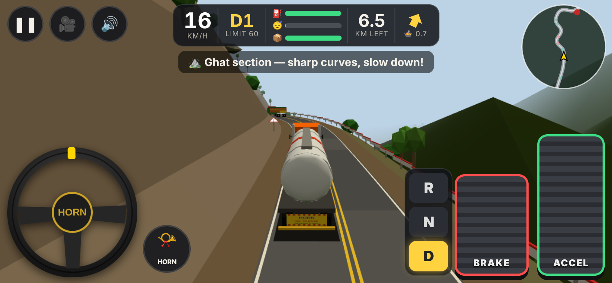

# India Truck Simulator

A free 3D truck driving game that runs in your phone's web browser. No install needed.
Drive a truck across Indian states, keep to the **left**, carry cargo, refuel at diesel pumps, rest at dhabas, and park in the depot bay to finish the delivery.

**▶ Play now: https://manish50.github.io/TruckStimulator/**

Turn your phone sideways: the game is played in **landscape only**.



## Features

- **5 trucks, all unlocked:** Mini Truck, Cargo Truck (10-wheeler), Trailer Truck, Highway Express (130 km/h) and Turbo Hauler (160 km/h).
- **Speed governor switch:** real Indian goods vehicles are limited to 80 km/h, and tankers and dumpers to 60 km/h. You can switch the limiter off for the fast trucks.
- **11 cargo jobs, all unlocked:** general goods, iron ore, wooden logs, new cars, diesel tanker, steel coils, container, fruits & vegetables, glass & electronics, cement and milk.
  - The load changes how the truck drives: weight affects pickup and braking, a high centre of gravity can tip the truck over, liquid loads slosh, and tall loads sway in the wind.
  - Fragile loads lose condition on hard braking and bumps.
- **Route map of India:** 14 cities in 11 states. Real distances are shortened so a trip takes about 5–15 minutes.
- **Changing scenery:**
  - cities with traffic signals, shops and junctions
  - open highways with fields and villages
  - ghat roads with hairpin curves and crash barriers
  - industrial areas
  - each state looks a little different: desert in Rajasthan, green fields in Uttar Pradesh, coconut palms in the south
  - state border gates and city name boards along the way
- **Living traffic:** cars, buses, auto-rickshaws, bikes, trucks and tractors keep left, stop at red lights, overtake, and cross at junctions.
- **Stops:** diesel pumps (fuel runs out) and dhabas (the tiredness meter blurs your vision). Both appear on the mini-map.
- **Crashes:**
  - camera shake, white flash, sparks, smoke and fire
  - flying debris and spilled cargo, dents
  - a cracked windshield in the driver view
  - rollovers
  - a 3-angle slow-motion replay
- **4 camera views:** driver seat (dashboard, gauges, steering wheel), side, top and back (chase).
- **Gauges and lights:**
  - an analog speedometer whose needle rises and falls as you accelerate and brake (red zone above the speed limit)
  - a fuel gauge (E–F) with a blinking low-fuel warning lamp, on the HUD and in the cab
  - headlights with a beam on the road, tail lamps, and a headlight indicator
  - choose **Day, Evening or Night** on the trip summary; at night other vehicles and street lamps glow, and driving without headlights costs stars
- **Sound made in code:** diesel engine synthesiser (firing pulses, knock, turbo whistle, exhaust brake), air horn, air brakes, tyre squeal, crash sounds, reverse beeper and traffic ambience. Mute button included.

## How to play

1. Tap **PLAY**, choose a truck, then a cargo.
2. On the map, tap a **FROM** city and a **TO** city (or use the drop-down lists). On the trip summary, pick Day, Evening or Night, then tap **START DRIVING**.
3. Drive:

| Control | What it does |
|---|---|
| Steering wheel (bottom-left) | Put a finger on the wheel and rotate it. It springs back to centre when you let go. Tap the centre for the horn. |
| ACCEL / BRAKE pedals (bottom-right) | Hold to press. You can use both thumbs at the same time. |
| R / N / D | Reverse, Neutral, Drive. Gears 1–6 change automatically. |
| 🎥 | Switch camera: back → driver → side → top |
| ❚❚ | Pause (Resume / Restart / Quit) |
| 🔊 | Mute / unmute |
| Headlight button (top-left) | Headlights on / off |
| ⛽ REFUEL / 🍲 REST | Appear when you stop inside a pump or dhaba bay on the left side of the road. |

4. **Win:** reach the destination depot and stop with the whole truck inside the **yellow parking bay** (a floating arrow marks it). You get 1–3 stars for speed, safe driving and parking accuracy, plus your earnings.
5. **Lose:** any crash, a rollover, or running out of diesel.

Tips:
- Slow down before sharp curves. The HUD warns you if you're going too fast for a turn.
- Stop at red lights; jumping them costs stars.
- Keep left!

On a computer you can use the keyboard:
- **W / ↑**: accelerate
- **S / ↓ / Space**: brake
- **A / D** or **← / →**: steer
- **1 / 2 / 3**: D / N / R
- **H**: horn
- **C**: camera
- **P**: pause
- **M**: mute
- **E**: refuel or rest
- **L**: headlights

## Run it locally

Any static web server works. For example:

```bash
python3 -m http.server 8080
```

Then open http://localhost:8080/. To run the automated phone-emulation test (it needs Playwright and Chromium):

```bash
node tools/mobile-test.cjs http://localhost:8080/ test-shots
```

## Project layout

```
index.html               the page (all screens + HUD)
css/style.css            layout and styles
js/main.js               app shell: screens, renderer, main loop
js/game.js               one trip: driving, stops, crashes, parking, scoring
js/world/                route generation, road mesh, scenery, 3D models
js/sim/                  truck physics, traffic AI, collisions, crash effects
js/ui/                   touch controls, mini-map, truck showroom, route map
js/audio/                sound effects and the diesel engine synthesiser
js/data/                 cities, states, trucks, cargo
js/lib/                  three.js (MIT)
```

All file paths are relative, so the game works from any folder, including GitHub Pages.

## Credits

| Asset | Source | License |
|---|---|---|
| 3D engine: `js/lib/three.module.min.js` (r160) | [three.js](https://threejs.org/), © 2010–2023 three.js authors | MIT, see `js/lib/three-LICENSE.txt` |
| Trucks, cars, buses, auto-rickshaws, bikes, tractors, buildings, trees, pumps, dhabas, signals, signs | Built in code from simple shapes (`js/world/models.js`, `js/world/scenery.js`) | Original work for this project |
| All sounds (engine, horn, brakes, crash, traffic) | Generated in code with the Web Audio API (`js/audio/`) | Original work for this project |
| Sign, dial and "HORN OK PLEASE" textures | Drawn at runtime on HTML canvas | Original work for this project |
| Map of India outline | Simplified hand-made outline (`js/data/cities.js`) | Original work for this project |
| App icon (`icons/icon.svg`) | Hand-written SVG | Original work for this project |
| Emoji icons in the UI | Your device's built-in emoji font | No image files included |

No external 3D model, sound or image files are used. All trucks and vehicles are generic and unbranded.

### Research references (ideas only, no code copied)

- Diesel engine sound as combustion pulses at the firing frequency (rpm/60 × cylinders/2 for a 4-stroke engine), with knock and exhaust resonance: [ghurni procedural engine synthesis](https://docs.rs/crate/ghurni/latest/source/README.md)
- Indian speed limits for goods vehicles (80 km/h; 60 km/h for tankers and dumpers) and speed governors (AIS-018): [MoRTH notification S.O. 1997(E)](https://morth.nic.in/sites/default/files/notifications_document/Notification_No_SO_1997E_dated_05082014.pdf), [wbxpress summary](https://wbxpress.com/transport-vehicles-speed-governor/)
- Trailer sway depending on load mass and centre of mass, and jack-knifing: [trailer-driving (HTML5 trailer simulation)](https://github.com/mcgratheg/trailer-driving)
- Soft-body truck crash simulation (concept reference only): [Rigs of Rods](https://ossblog.org/rigs-of-rods)
